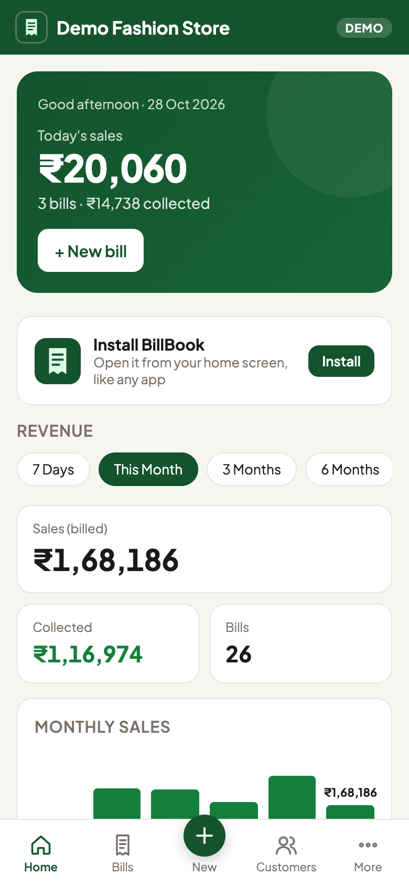
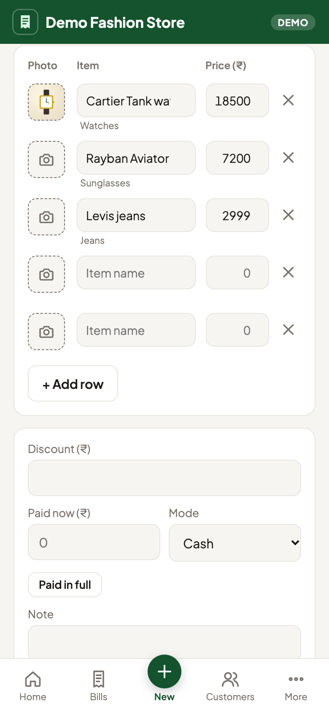
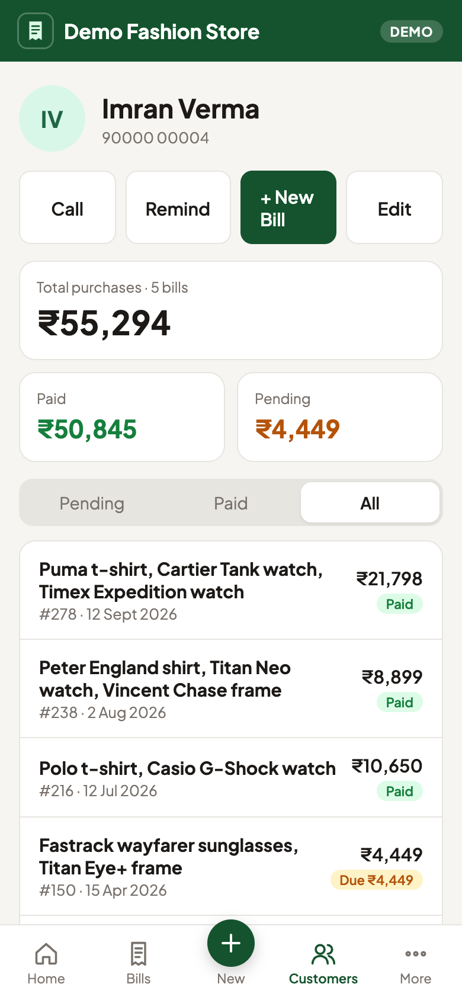
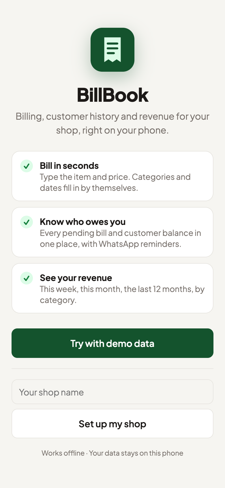
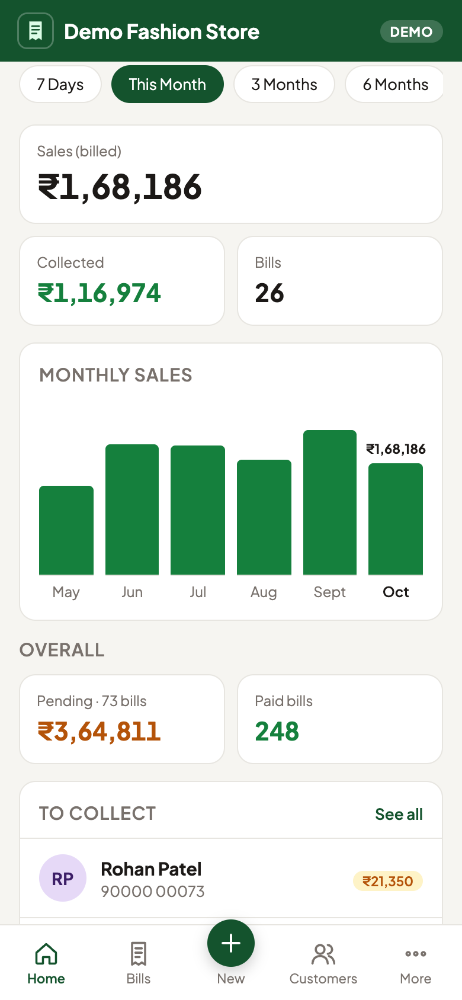
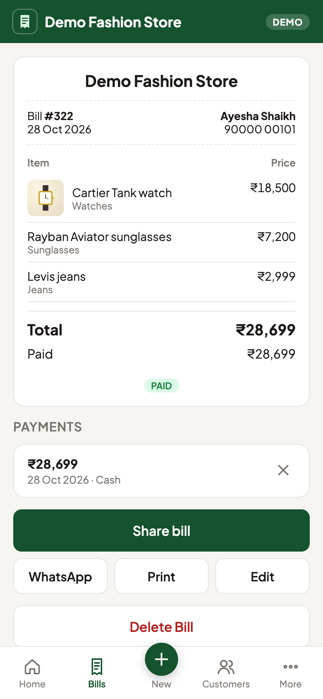
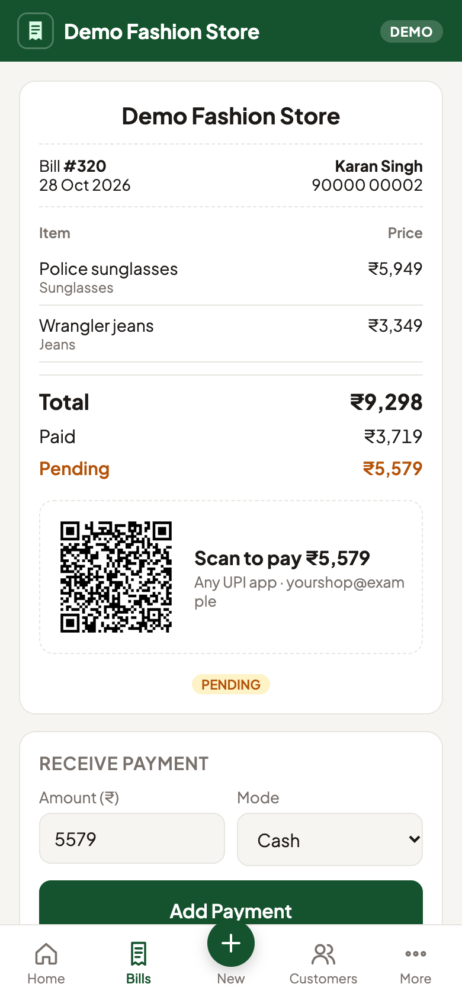
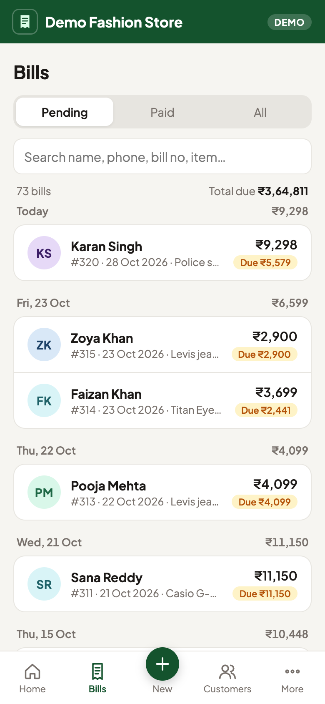

<p align="center">
  
</p>

<h1 align="center">BillBook</h1>

<p align="center">
  <b>Billing for your shop, right on your phone.</b><br>
  Make bills in seconds, know exactly who owes you, and see your revenue at a glance.
</p>

<p align="center">
  <a href="https://hatim-neral.github.io/billing/"><b>▶ Open the live demo</b></a>
</p>

<p align="center">
  
  
  
</p>

---

## Why BillBook

Made for shops that sell watches, sunglasses, frames, clothing and similar goods, and that still keep credit and customer history in a notebook.

- **Bills in seconds.** Type *"Cartier watch"*, tap Next, type *10000*. The category and date are filled in for you, and items you've sold before are suggested with their last price.
- **Product photos.** Take a photo of the item, or choose one from the gallery, right on the bill.
- **Get paid faster.** Pending bills show a **scan-to-pay UPI QR** for the exact amount. Take part-payments and send a **WhatsApp reminder** in one tap.
- **Know who owes you.** Every pending bill and customer balance in one place, with the biggest dues on your home screen.
- **Full customer history.** Search by name or phone to see everything they have bought, paid and still owe.
- **See your revenue.** Today, 7 days, this month, 3, 6 or 12 months, or lifetime. Includes a monthly sales chart and sales by category.
- **Share and print.** Share the bill as a picture (product photos and payment QR included), send it as a WhatsApp message, or print it.
- **Works offline, no sign-up.** Install it on Android from Chrome. Your data stays on your phone.

## Try it

1. Open **https://hatim-neral.github.io/billing/** on your phone in Chrome.
2. Tap **Try with demo data** to explore it with 100 sample customers. You can remove them later under **More**.
3. Under **More**, add your UPI ID to show a scan-to-pay QR on pending bills.
4. To install it like an app, tap **Install** on the home screen, or open Chrome's menu and choose **Add to Home screen**.

<p align="center">
  
  
  
  
  
</p>

## Your data

Everything is stored on the device: bills and customers in the browser's local storage, and photos in IndexedDB. Nothing is sent to a server. Use **More → Download backup** regularly. The backup includes photos and can be restored on any phone.

## For developers

There is no build step and no dependencies. It is plain HTML, CSS and JavaScript.

```sh
python3 -m http.server 8000   # then open http://localhost:8000
```

| File | Purpose |
| --- | --- |
| `index.html` | App shell, navigation, link-preview tags |
| `app.js` | All screens, storage and logic |
| `sample.js` | Optional demo data generator |
| `styles.css` | Styles for light and dark mode |
| `manifest.json`, `sw.js`, `icons/` | Installable app and offline support |
